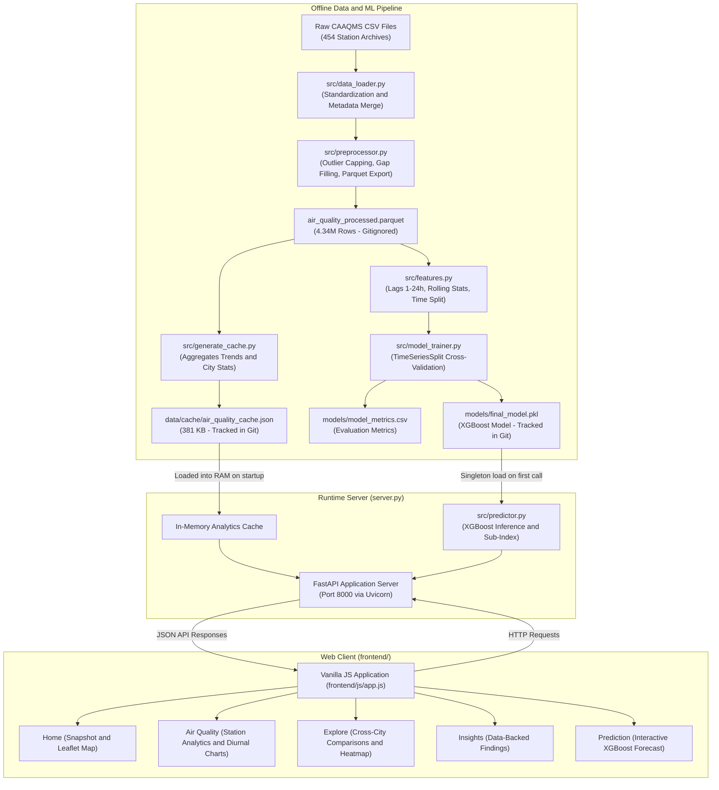

# AIRWISE: Air Quality Analysis and Prediction
[](https://www.python.org/)

[](https://fastapi.tiangolo.com/)

[](https://xgboost.readthedocs.io/)

[](https://scikit-learn.org/)

[](https://plotly.com/)

[](tests)

AIRWISE is a local environmental intelligence and time-series forecasting application for Indian ambient air quality. It analyzes historical CPCB monitoring observations from 10 Indian cities and 130 stations, covering 2010-02-17 through 2023-03-31. It visualizes spatial and temporal patterns and provides one-hour-ahead PM2.5 forecasts using XGBoost. The bundled archive is historical, not a live feed, and contains missing station-hours.

---

## Table of Contents
- [Overview and Problem Statement](#overview-and-problem-statement)

- [Key Features](#key-features)

- [System Architecture and Data Flow](#system-architecture-and-data-flow)

- [Machine Learning Methodology](#machine-learning-methodology)

  - [Forecasting Objective and Horizon](#forecasting-objective-and-horizon)

  - [Feature Engineering and Leakage Prevention](#feature-engineering-and-leakage-prevention)

  - [Model Evaluation and Generalization Metrics](#model-evaluation-and-generalization-metrics)

- [PM2.5 Prediction and NAQI Sub-Index Calculation](#pm25-prediction-and-naqi-sub-index-calculation)

- [Portability and Dataset Independence](#portability-and-dataset-independence)

  - [Tracked Runtime Files vs Excluded Datasets](#tracked-runtime-files-vs-excluded-datasets)

  - [Startup Logic on a Fresh Clone](#startup-logic-on-a-fresh-clone)

  - [Offline Operation and Limitations](#offline-operation-and-limitations)

- [Repository Structure](#repository-structure)

- [Installation and Setup](#installation-and-setup)

  - [Prerequisites](#prerequisites)

  - [Windows Setup (PowerShell)](#windows-setup-powershell)

  - [macOS and Linux Setup](#macos-and-linux-setup)

- [Dashboard Walkthrough](#dashboard-walkthrough)

- [API Reference](#api-reference)

  - [Endpoints Summary](#endpoints-summary)

  - [Prediction Endpoint (Illustrative Example)](#prediction-endpoint-illustrative-example)

- [Testing and Verification](#testing-and-verification)

- [Limitations](#limitations)

- [Roadmap](#roadmap)

- [License and Attribution](#license-and-attribution)

---

## Overview and Problem Statement
Fine particulate matter (PM2.5) is a primary contributor to severe air pollution episodes across Indian urban areas. In winter months, meteorological factors such as boundary-layer thermal inversion, combined with vehicular and regional emissions, regularly cause particulate concentrations to spike across northern and eastern corridors.

Continuous Ambient Air Quality Monitoring Station (CAAQMS) records published by the CPCB provide rich historical data, but working with them presents several practical engineering problems:

- **Data volume and fragmentation:** Hundreds of station CSV files with minor header variations and missing metadata.

- **Sensor noise and gaps:** Missing data periods, calibration offsets, impossible negative values, and extreme outliers.

- **Temporal data leakage:** Shuffling time-series observations across training and testing sets leads to artificially inflated validation metrics that fail in real-world forecasting.

- **Query latency:** Scanning multi-million-row time-series datasets during web requests causes unacceptable delays.

AIRWISE addresses these challenges by:

1. Providing an offline cleaning and feature pipeline that processes 4.34 million station records and splits data strictly by time.

2. Training and serializing an XGBoost regressor that predicts 1-hour-ahead PM2.5 levels.

3. Using a pre-computed JSON aggregation cache ([data/cache/air_quality_cache.json](data/cache/air_quality_cache.json)) so the FastAPI backend can respond quickly without running queries against raw CSV or Parquet files at runtime.

4. Serving an interactive web dashboard with zero Node.js build dependencies and locally bundled JavaScript libraries.

---

## Key Features
The application is organized into five functional dashboard views:

### 1. Home
- **City selector:** Switch between 10 major metropolitan centers: Delhi, Mumbai, Bengaluru, Chennai, Kolkata, Hyderabad, Lucknow, Ahmedabad, Patna, and Pune.

- **Snapshot card:** Displays the latest recorded PM2.5 observation, corresponding CPCB category badge, meteorological stats (temperature, relative humidity, wind speed), and health advice.

- **India station map:** Interactive Leaflet map displaying monitoring centers color-coded by overall PM2.5 category, with clickable stations updating the snapshot panel.

- **Insight cards:** Summarizes key environmental findings, such as winter pollution surges and commute-hour peaks.

### 2. Air Quality
- **Station-level breakdown:** Filter by specific CAAQMS monitoring stations (e.g., Anand Vihar or IGI Airport in Delhi; BTM Layout in Bengaluru) or view city-wide averages.

- **6-pollutant comparison:** Shows concentrations for PM2.5, PM10, NO2, SO2, CO, and Ozone alongside official CPCB safe exposure thresholds.

- **24-hour historical trajectory:** Client-side Plotly line chart displaying hourly pollutant concentrations over the preceding 24 hours.

- **Diurnal cycle chart:** Visualizes average hour-of-day concentration patterns.

- **Health precautions:** Displays practical cautionary advice targeted at sensitive populations.

### 3. Explore
- **Cross-city rankings:** Ranked bar charts comparing mean and median particulate concentrations across all 10 monitored cities.

- **Correlation heatmap:** Interactive Pearson correlation matrix showing co-movement between pollutants (e.g., PM2.5, PM10, and NOx).

- **Long-term trajectories (2010–2023):** Multi-year trend lines showing historical annual changes across cities.

- **Seasonal comparison:** Breakdown comparing particulate levels across Winter, Summer, Monsoon, and Post-Monsoon.

### 4. Insights
- **Pollution hotspots:** Quantitative identification of consistently elevated corridors (Patna, Delhi, Lucknow).

- **Seasonal inversion ratio:** Documents the historical ~3.5x to 4.0x winter-to-monsoon particulate ratio caused by cold-weather atmospheric trapping.

- **Diurnal commute peaks:** Details morning traffic waves (08:00–10:00) and nocturnal compression peaks (20:00–23:00) versus afternoon dispersion troughs.

- **Smog chronology:** Retrospective look at documented severe pollution episodes.

### 5. Prediction
- **Input parameters:** Sliders and inputs for current PM2.5, previous lags (2h, 3h), temperature, relative humidity, wind speed, co-pollutants (NO2, CO, SO2, Ozone), month, hour, and weekend status.

- **Preset scenarios:** One-click presets for common situations (**Delhi Winter Smog**, **Monsoon Clean Air**, **Summer Dust Storm**, **Moderate Urban Day**).

- **Forecast results:** Submits parameters to the backend XGBoost model, returning the predicted next-hour PM2.5 concentration, the derived PM2.5 NAQI sub-index, and associated CPCB health guidance.

---

## System Architecture and Data Flow


---

## Machine Learning Methodology
### Forecasting Objective and Horizon
- **Target:** Ambient PM2.5 concentration (in µg/m³) at hour t.

- **Horizon:** 1-hour-ahead regression forecast.

- **Inputs:** Environmental observations, historical lags, and temporal indicators available at or prior to hour t-1.

### Feature Engineering and Leakage Prevention
Feature construction is station-aware and timestamp-aware. The target is PM2.5 at timestamp t; the forecast inputs must come from the previous observation hour where applicable.

- **Pollutant Lags:** Exact timestamp lookups for PM2.5 at t-1h, t-2h, t-3h, t-6h, t-12h, and t-24h. Missing clock-hours are not treated as adjacent observations.

- **Rolling Statistics:** Time-based 3-hour, 6-hour, and 24-hour rolling means and standard deviations that exclude the target observation.

- **Co-Pollutants:** NO2, CO, SO2, Ozone, and NOx use their exact preceding-hour values where available.

- **Meteorological Indicators:** Temperature, relative humidity, wind speed, solar radiation, and barometric pressure are aligned to the preceding clock hour.

- **Calendar & Time Indicators:** Hour, month, day of week, season index, and weekend flag for the forecast target.

- **Chronological Data Split:** The corrected model run partitions rows by unique timestamps:

  - **Training:** Before 2019-06-11 16:00:00; 1,167,513 rows available, of which 800,000 were sampled for fitting.

  - **Validation:** 2019-06-11 16:00:00 through before 2021-05-06 08:00:00 (1,285,756 rows).

  - **Test:** From 2021-05-06 08:00:00 to the final archive timestamp, 2023-03-31 23:00:00 (1,638,400 rows).

### Model Evaluation and Generalization Metrics
The promoted model is an XGBoost regressor trained with the timestamp-aligned feature pipeline. The corrected training run evaluated this configuration against a persistence baseline using chronological validation and test periods.

The promoted model, **XGBoost (timestamp-aligned)**, is saved to [models/final_model.pkl](models/final_model.pkl). Its validation and held-out test metrics are listed below:

| Model | Val MAE (µg/m³) | Val RMSE (µg/m³) | Val R² | Test MAE (µg/m³) | Test RMSE (µg/m³) | Test R² | Training Time (s) |
| :--- | :---: | :---: | :---: | :---: | :---: | :---: | :---: |
| **XGBoost (timestamp-aligned)** | **9.8476** | **18.4421** | **0.9463** | **9.1604** | **18.4241** | **0.9295** | — |

> **Evaluation Scope:** The held-out test period begins on 2021-05-06 and ends at the final dataset timestamp, 2023-03-31 23:00. The model achieved R²=0.9295, MAE=9.1604 µg/m³, and RMSE=18.4241 µg/m³. It reduced test RMSE by 11.53% compared with the persistence baseline on the same rows. These are historical offline metrics, not guarantees of live-field accuracy.

---

## PM2.5 Prediction and NAQI Sub-Index Calculation
### Distinguishing PM2.5 Prediction from Full Composite NAQI
Under official CPCB National Air Quality Index (NAQI) guidelines, a complete composite AQI requires calculating sub-indices for at least three pollutants (including at least PM10 or PM2.5) from 24-hour averages, where the overall index is the maximum sub-index: AQI = max(I_1, I_2, ..., I_n).

In AIRWISE, the machine learning model specifically predicts the **1-hour-ahead PM2.5 concentration**. From this predicted value, the application derives a **PM2.5 AQI sub-index** using the official CPCB piecewise linear formula. It is not a complete multi-pollutant composite AQI forecast.

### Breakpoint Formula
$$

I = \frac{I_{\text{high}} - I_{\text{low}}}{B_{\text{high}} - B_{\text{low}}} \times (C - B_{\text{low}}) + I_{\text{low}}

$$

```text
I = [ (I_high - I_low) / (B_high - B_low) ] * (C - B_low) + I_low
```

Where:

- `C` is the predicted PM2.5 concentration in µg/m³ (clamped to >= 0).

- `[B_low, B_high]` is the CPCB PM2.5 concentration breakpoint range.

- `[I_low, I_high]` is the corresponding index sub-range.

### CPCB Breakpoint Mapping
| Concentration (C in µg/m³) | Sub-Index Range (I) | NAQI Category | Category Color | CPCB Public Health Advisory |
| :---: | :---: | :---: | :---: | :--- |
| **0.0 – 30.0** | **0 – 50** | **Good** | `#10b981` | Minimal impact. Air quality is clean and poses little or no risk. |
| **30.1 – 60.0** | **51 – 100** | **Satisfactory** | `#84cc16` | Minor breathing discomfort to sensitive individuals. |
| **60.1 – 90.0** | **101 – 200** | **Moderate** | `#f59e0b` | Breathing discomfort to people with lung disease, asthma, and heart conditions. |
| **90.1 – 120.0** | **201 – 300** | **Poor** | `#f97316` | Breathing discomfort to most people on prolonged exposure. |
| **120.1 – 250.0** | **301 – 400** | **Very Poor** | `#ef4444` | Respiratory illness on prolonged exposure; significant impact on vulnerable groups. |
| **> 250.0** | **401 – 500** | **Severe** | `#7f1d1d` | Serious health impact; affects healthy people and severely impacts vulnerable groups. |

*Disclaimer: Health advisories represent official CPCB public guidelines and are provided for educational and informational purposes. They do not constitute clinical or certified medical advice.*

---

## Portability and Dataset Independence
### Tracked Runtime Files vs Excluded Datasets
AIRWISE is designed to run immediately after cloning without requiring large dataset downloads or model training:

| Path | Tracked in Git? | File Size | Description |
| :--- | :---: | :---: | :--- |
| [data/cache/air_quality_cache.json](data/cache/air_quality_cache.json) | **Yes** | 2.35 MB | Precomputed analytics from historical observations; not current live readings. |
| [models/final_model.pkl](models/final_model.pkl) | **Yes** | 2.38 MB | Promoted XGBoost model for one-hour-ahead PM2.5 prediction. |
| [models/preprocessor.pkl](models/preprocessor.pkl) | **Yes** | 2.8 KB | Feature names and training-set medians used during inference. |
| [models/model_metrics.csv](models/model_metrics.csv) | **Yes** | 160 B | Promoted model validation and test metrics. |
| [models/final_model_evaluation.json](models/final_model_evaluation.json) | **Yes** | 1.56 KB | Model evaluation and persistence-baseline comparison. |
| [frontend/static/vendor/](frontend/static/vendor) | **Yes** | ~5.0 MB | Bundled Leaflet and Plotly.js vendor libraries. |
| `data/raw/*.csv` | **No** (GitIgnored) | ~2 GB | 454 raw CPCB station archives (only needed for retraining). |
| `data/processed/*.parquet` | **No** (GitIgnored) | Approximately 114 MB locally | Needed for retraining and candidate evaluation, not normal dashboard inference. |
| `reports/figures/*.html` | **No** (GitIgnored) | — | Generated standalone interactive figures. |

### Startup Logic on a Fresh Clone
1. When [server.py](server.py) starts, it checks for `data/cache/air_quality_cache.json`.

2. Because this file is committed to Git, the server loads it into memory immediately.

3. Prediction requests use the committed [models/final_model.pkl](models/final_model.pkl) artifact.

4. **Conclusion:** You do not need the 2 GB raw CSV files, the 301 MB Parquet file, or the model training scripts to run the web application on a fresh machine.

> **Caution:** Do not delete `data/cache/air_quality_cache.json`. If deleted, the server will attempt to run `src/generate_cache.py`, which requires the raw CAAQMS dataset.

### Offline Operation and Limitations
- **Local Application Core:** The FastAPI server, in-memory cache, XGBoost inference engine, and Plotly charts run entirely on the local machine without internet access.

- **Locally Bundled Assets:** Leaflet and Plotly.js are stored in [frontend/static/vendor/](frontend/static/vendor), eliminating external CDN dependencies.

- **Map Tile Limitation:** The Leaflet map in the Home view fetches base map imagery from `https://tile.openstreetmap.org/{z}/{x}/{y}.png`.

  - **When online:** Map renders with full OpenStreetMap geographic tiles.

  - **When offline:** Leaflet initializes and displays city station markers and hover tooltips, but the map background will appear as an empty grid unless tiles were previously cached by the browser.

---

## Repository Structure
```text
air-quality-analysis/
├── data/
│   ├── cache/
│   │   └── air_quality_cache.json       # Precomputed analytics cache (381 KB, tracked in Git)
│   ├── processed/                       # Local directory for processed Parquet (gitignored)
│   └── raw/                             # Local directory for raw CPCB station CSVs (gitignored)
│
├── frontend/                            # Single-page web dashboard
│   ├── css/
│   │   └── styles.css                   # Custom styling and CPCB color tokens
│   ├── js/
│   │   ├── app.js                       # State management, API client, router
│   │   ├── home.js                      # Home view: Snapshot, city search, Leaflet map
│   │   ├── air_quality.js               # Station view: 6-pollutant breakdown, 24h and diurnal charts
│   │   ├── explore.js                   # Cross-city comparison, correlation heatmaps, multi-year trends
│   │   ├── insights.js                  # Analytical deep-dives: Hotspots, winter inversion, commute waves
│   │   └── prediction.js                # ML forecasting form, preset scenario handlers, advisory cards
│   ├── static/vendor/                   # Offline vendor libraries
│   │   ├── leaflet.css & leaflet.js     # Leaflet mapping engine (v1.9.4)
│   │   └── plotly.min.js                # Plotly graphing library (v2.x, 4.8 MB)
│   ├── index.html                       # Application HTML entry point
│   ├── privacy-policy.html              # Privacy policy page
│   └── terms.html                       # Terms and conditions page
│
├── models/
│   ├── final_model.pkl                  # Serialized XGBoost Regressor (2.61 MB, tracked in Git)
│   ├── preprocessor.pkl                 # Serialized feature transformation pipeline (961 B, tracked in Git)
│   └── model_metrics.csv                # Benchmark evaluation results (MAE, RMSE, R2, training time)
│
├── reports/
│   └── figures/                         # Output directory for generated figures (.gitkeep)
│
├── src/                                 # Python source package
│   ├── __init__.py                      # Package marker
│   ├── config.py                        # Centralized paths, column mappings, CPCB breakpoints, split dates
│   ├── data_loader.py                   # Low-memory ingestion of raw CSVs and metadata merge
│   ├── preprocessor.py                  # Gap filling, outlier capping, negative cleanup, NAQI formula
│   ├── features.py                      # Leak-free lag/rolling features and chronological split
│   ├── model_trainer.py                 # Model evaluation suite, TimeSeriesSplit CV, hyperparameter tuning
│   ├── predictor.py                     # Inference engine, training-median imputer, CPCB health guidance
│   ├── eda.py                           # 12 modular Plotly and Matplotlib visualization functions
│   └── generate_cache.py                # Aggregates processed Parquet into air_quality_cache.json
│
├── tests/                               # Automated test suite (17 passed)
│   ├── test_api.py                      # Integration tests for all FastAPI endpoints
│   ├── test_features.py                 # Tests for lag shifts, rolling windows, and split bounds
│   ├── test_predictor.py                # Tests for scalar breakpoints, negative clamping, category metadata
│   └── test_preprocessor.py             # Tests for NAQI formulas, non-negative bounds, outlier limits
│
├── server.py                            # FastAPI backend application and static asset server
├── requirements.txt                     # Python dependencies (Python 3.13+)
├── pytest.ini                           # Pytest configuration (pythonpath = .)
└── .gitignore                           # Git ignore rules
```

---

## Installation and Setup
### Prerequisites
- **Git:** [git-scm.com](https://git-scm.com/downloads)

- **Python 3.13:** [python.org/downloads](https://www.python.org/downloads/)

  - **Tested Python version:** **Python 3.13.11** (64-bit Windows).

  - **Minimum supported version:** Python 3.13 is required by dependency versions in [requirements.txt](requirements.txt) (`pandas>=2.3.0`, `scikit-learn>=1.7.0`, `xgboost>=3.4.0`).

  - **Compatibility note:** Do not assume future Python versions (such as Python 3.14) will work until binary wheels for compiled packages are released and verified.

  - **Windows note:** Check **"Add python.exe to PATH"** during installation.

Verify your installed versions:

```bash
git --version
python --version   # Or: py --version on Windows
```

---

### Windows Setup (PowerShell)
```powershell
# 1. Clone the repository
git clone https://github.com/Shakir-j/air-quality-analysis.git
cd air-quality-analysis
# 2. Create a virtual environment with Python 3.13 explicitly
py -3.13 -m venv .venv
# 3. Activate the virtual environment
.\.venv\Scripts\Activate.ps1
# (If PowerShell blocks script execution, run:
# Set-ExecutionPolicy -Scope Process -ExecutionPolicy Bypass)
# 4. Upgrade pip and install dependencies
python -m pip install --upgrade pip
pip install -r requirements.txt
# 5. Start the application server
python server.py
```

Open your browser to: **`http://127.0.0.1:8000`**

To stop the server, press `Ctrl + C` in the PowerShell window.

---

### macOS and Linux Setup
```bash
# 1. Clone the repository
git clone https://github.com/Shakir-j/air-quality-analysis.git
cd air-quality-analysis
# 2. Create a virtual environment using Python 3.13
python3.13 -m venv .venv
# 3. Activate the virtual environment
source .venv/bin/activate
# 4. Upgrade pip and install dependencies
pip install --upgrade pip
pip install -r requirements.txt
# 5. Start the application server
python server.py
```

Open your browser to: **`http://127.0.0.1:8000`**

---

## Dashboard Walkthrough
### 1. City Overview (Home)
- Use the **Search a city or monitoring station...** dropdown to switch between monitored metropolitan areas.

- The snapshot card updates with current particulate observations, the corresponding NAQI category badge, and weather readings.

- Click any station point on the interactive map to inspect that location.

### 2. Station Deep-Dive (Air Quality)
- Navigate to the **Air Quality** tab.

- Use the **Station** dropdown to select an individual CAAQMS station (e.g., **Anand Vihar** in Delhi or **BTM Layout** in Bengaluru).

- Review the six pollutant comparison bars against CPCB limits.

- Inspect the 24-hour historical trend and diurnal cycle Plotly charts.

### 3. Cross-City Analytics (Explore)
- Navigate to the **Explore** tab to compare average particulate levels across all 10 cities.

- Review the multi-pollutant Pearson correlation matrix to see relationships between particulate and gaseous pollutants.

### 4. Predicting Next-Hour Air Quality (Prediction)
- Navigate to the **Prediction** tab.

- Select a scenario preset (such as **Delhi Winter Smog Episode**) or configure custom parameters.

- Click **Predict Air Quality**.

- The system returns the forecasted PM2.5 level, the derived CPCB sub-index, and public health recommendations.

---

## API Reference
The FastAPI backend runs at base URL `http://127.0.0.1:8000`.

### Endpoints Summary
| Method | Endpoint | Query / Body Parameters | Description |
| :---: | :--- | :--- | :--- |
| `GET` | `/` | None | Serves the single-page application ([frontend/index.html](frontend/index.html)). |
| `GET` | `/privacy-policy` | None | Serves the privacy policy page ([frontend/privacy-policy.html](frontend/privacy-policy.html)). |
| `GET` | `/terms` | None | Serves the terms and conditions page ([frontend/terms.html](frontend/terms.html)). |
| `GET` | `/api/locations` | None | Returns metadata, coordinates, station counts, and historical metrics for all 10 cities. |
| `GET` | `/api/air-quality` | `city` (string, default: `"Delhi"`)\<br>`station` (string, optional) | Returns city/station snapshot, pollutant breakdown, 24h recent trend, and diurnal cycle. |
| `GET` | `/api/trends` | `city` (string, default: `"Delhi"`)\<br>`pollutant` (string, default: `"PM2.5"`) | Historical monthly and yearly trends (2010–2023). |
| `GET` | `/api/comparison` | `cities` (comma-separated, optional)\<br>`pollutant` (string, default: `"PM2.5"`) | Cross-city metrics, correlation matrix, and seasonal patterns. |
| `GET` | `/api/insights` | None | Aggregated data on hotspots, seasonal inversion ratios, and diurnal peaks. |
| `POST`| `/api/prediction` | JSON Body (`PredictionRequest`) | Runs XGBoost inference for next-hour PM2.5 and computes derived CPCB NAQI sub-index. |

---

### Prediction Endpoint (Illustrative Example)
#### Request Schema: POST /api/prediction
**Headers:** `Content-Type: application/json`

The request body accepts the following fields validated by Pydantic:

- `pm25_current` **(required float, 0.0 to 1000.0)**: Current PM2.5 concentration in µg/m³.

- `city` **(optional string, default: "Delhi")**: Target city name.

- `pm25_lag_2h` **(optional float, 0.0 to 1000.0)**: PM2.5 concentration 2 hours prior.

- `pm25_lag_3h` **(optional float, 0.0 to 1000.0)**: PM2.5 concentration 3 hours prior.

- `no2` **(optional float, 0.0 to 500.0)**: Current NO2 concentration in µg/m³.

- `co` **(optional float, 0.0 to 50.0)**: Current CO concentration in mg/m³.

- `so2` **(optional float, 0.0 to 300.0)**: Current SO2 concentration in µg/m³.

- `ozone` **(optional float, 0.0 to 500.0)**: Current Ozone concentration in µg/m³.

- `relative_humidity` **(optional float, 0.0 to 100.0)**: Relative humidity percentage.

- `wind_speed` **(optional float, 0.0 to 30.0)**: Wind speed in m/s.

- `temperature` **(optional float, -20.0 to 60.0)**: Ambient temperature in °C.

- `month` **(optional integer, 1 to 12, default: 11)**: Calendar month.

- `hour` **(optional integer, 0 to 23, default: 18)**: Hour of day.

- `is_weekend` **(optional integer, 0 or 1, default: 0)**: Weekend flag.

#### Illustrative Request Body
```json
{
  "city": "Delhi",
  "pm25_current": 145.0,
  "pm25_lag_2h": 138.0,
  "pm25_lag_3h": 125.0,
  "temperature": 16.5,
  "relative_humidity": 82.0,
  "wind_speed": 0.8,
  "no2": 45.0,
  "co": 1.8,
  "so2": 15.0,
  "ozone": 22.0,
  "month": 11,
  "hour": 21,
  "is_weekend": 0
}
```

#### Illustrative Response Body (200 OK)
```json
{
  "status": "success",
  "predicted_pm25": 141.2,
  "predicted_aqi": 316.3,
  "aqi_category": "Very Poor",
  "color": "#ef4444",
  "badge_bg": "rgba(239, 68, 68, 0.15)",
  "advisory": "Respiratory illness on prolonged exposure. Significant health impact on vulnerable groups.",
  "precautions": [
    "Avoid outdoor physical activity and exercise; keep windows shut.",
    "Use certified HEPA air filtration indoors where accessible.",
    "Wear an effective N95/N99 respirator mask if going outside is unavoidable."
  ],
  "provenance": "Model prediction (1-hour ahead forecast)"
}
```

---

## Testing and Verification
The latest local verification passed all 38 automated tests. Browser verification passed all five views and reported zero severe JavaScript console errors. The suite covers API routes, time-aware feature engineering, prediction behavior, and AQI sub-index logic:

- [tests/test_api.py](tests/test_api.py): Tests HTTP status codes, output schemas, 10-city counts, and payload responses across all API endpoints.

- [tests/test_features.py](tests/test_features.py): Verifies exact-timestamp lag alignment across missing hours, rolling-window exclusion of the target observation, and exact preceding-hour co-pollutant values.

- [tests/test_predictor.py](tests/test_predictor.py): Tests scalar NAQI conversions across all six CPCB category ranges, negative concentration clamping, and category metadata completeness.

- [tests/test_preprocessor.py](tests/test_preprocessor.py): Tests CPCB NAQI mathematical breakpoints, vectorized pandas series conversions, non-negative variable definitions, and sensor outlier caps (PM2.5 <= 500 µg/m³, RH <= 100%, WS <= 50 m/s).

### Running Tests
Ensure your virtual environment is active, then run:

```bash
pytest tests/ -v
```

**Latest local verification:** 38 automated tests passed. Browser verification passed all five views with zero severe JavaScript console errors.

---

## Limitations
- **Forecast Horizon:** The machine learning model provides a 1-hour-ahead forecast. It is not designed for multi-day or seasonal forecasts.

- **Sub-Index vs. Composite AQI:** Predictions reflect the PM2.5 sub-index derived from estimated PM2.5 concentrations, rather than a full multi-pollutant composite NAQI.

- **Map Background Online Dependency:** Leaflet tile rendering depends on network connectivity to OpenStreetMap servers. In offline environments without cached tiles, city markers and tooltips render on an empty grid.

- **Cache Regeneration Requirement:** The application runs out of the box because `data/cache/air_quality_cache.json` is committed. If this file is deleted, regenerating it requires the original raw CAAQMS station CSV files, which are excluded from Git due to their size (~2 GB).

---

## Roadmap
The following items represent potential future enhancements (distinguished from currently functional features):

- **Deployment:** Provide a Dockerfile and docker-compose configuration for containerized deployment.

- **CI/CD:** Set up GitHub Actions workflows to run pytest automatically on push and pull requests.

- **Multi-Step Modeling:** Implement multi-horizon 24-hour sequence forecasting using recurrent or transformer-based architectures (LSTM/TFT).

- **Spatial Modeling:** Explore Spatial Graph Neural Networks (GNNs) incorporating inter-station wind vector matrices.

- **Remote Sensing:** Integrate NASA MODIS/VIIRS satellite Aerosol Optical Depth (AOD) data to monitor regional biomass burning plumes.

---

## License and Attribution
- **Repository:** [https://github.com/Shakir-j/air-quality-analysis](https://github.com/Shakir-j/air-quality-analysis)

- **Data Source:** Ambient air quality records sourced from the Central Pollution Control Board (CPCB), Ministry of Environment, Forest and Climate Change, Government of India.

- **License Status:** Previous repository documentation referenced the MIT License; however, no standalone `LICENSE` text file is currently committed to the repository root. Licensing terms remain subject to the repository maintainer formally adding a `LICENSE` file.
